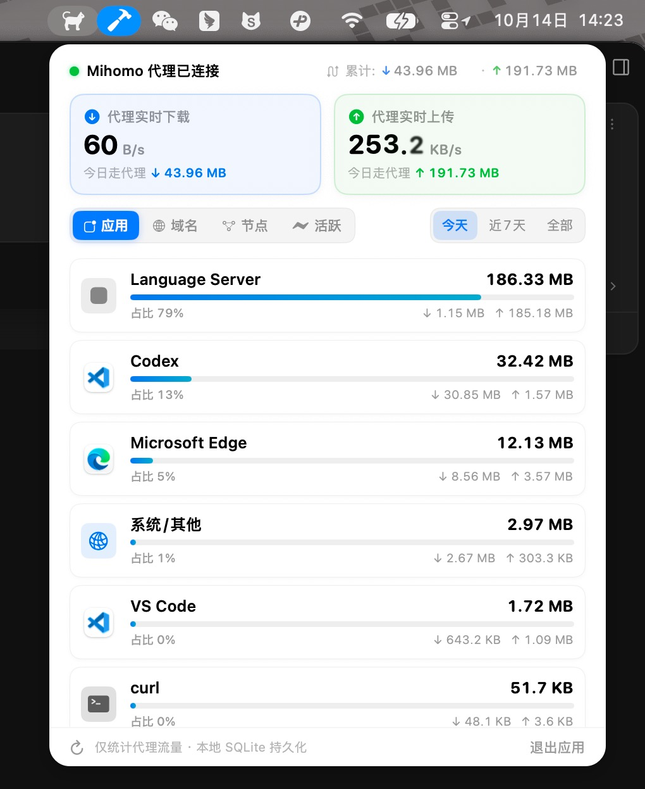

<div align="center">


# Mihomo Monitor
### 专注「代理流量」的 macOS 菜单栏统计小工具

<p>
  
  
  
  
  
</p>

**只要走代理，统统看得清。**  
自动过滤国内直连，常驻 Mac 菜单栏，清晰记录各个应用程序、浏览器、终端脚本以及各类 AI 软件消耗的上传与下载流量；并内置纯原生 macOS 系统性能监控。

[📥 下载 v0.2.0 DMG 安装包](https://github.com/Jolly-J/MihomoMonitor/releases/download/v0.2.0/MihomoMonitor-v0.2.0.dmg) · [✨ 功能特点](#-功能特点) · [🤝 欢迎共创](#-写在前面--欢迎共创)

</div>

---

## 💡 为什么做这个项目？

我是个编程爱好者，这也是一个日常 **Vibe Coding** 出来的实用小玩具。

最初的起因其实很单纯：平时写代码、折腾各种 AI 工具和 Agent（比如 Claude Code、Cursor、各种自动化跑任务的脚本），它们经常在后台频繁发送长上下文或抓取网页，流量跑得飞快，却不知道具体是哪个应用占用了多少。

但写着写着发现，这个痛点远不止于 AI —— 只要日常挂着代理，机场流量经常莫名其妙跑了几十上百 GB：
- 到底是哪个浏览器标签在后台偷偷跑流量？
- 还是终端脚本、海外应用在后台同步？
- 现有的代理软件大多只能看一眼瞬时速率，关掉窗口历史记录就没了；系统自带的活动监视器又把看视频、微信大文件等**国内直连流量**和**出海代理**混在一起，根本分不清真实的代理账本。

所以就有了这个小工具，逻辑很纯粹：  
**过滤掉国内直连，只要是走代理出海的流量，无论什么软件或服务，统统分门别类记录下来，随时在菜单栏看一眼。**

---

## 🖥️ 界面预览

<div align="center">
  
</div>

---

## ✨ 功能特点

- **只统计代理流量**：自动过滤 Direct 直连与 Reject，100% 专注走代理出海的流量消耗。
- **全应用自动归因**：无论是 Chrome/Safari 等浏览器、日常出海软件、终端命令行，还是各类 AI 编程助手与 Agent，全部自动识别所属进程并展示对应图标。
- **原生系统监控**：基于纯原生 Darwin C 接口（零子进程），实时监控主机全核 CPU 绝对利用率、物理内存真实用量与 Top 进程动态排行，附带丝滑排序过渡动效。
- **多维度查看**：
  - **应用排行**：直观看到各个软件消耗的上传与下载量以及占比；
  - **域名透视**：查看哪些大模型 API 或外网域名流量最高，支持即时搜索与复制；
  - **节点分布**：查看各个代理节点的分流情况；
  - **活跃连接**：实时看当前后台有哪些连接正在传输。
- **本地持久化账本**：支持按「今天」、「近 7 天」和「历史全部」查看，数据保存在本地 SQLite（WAL 模式），安全且断网断电不丢。
- **原生 macOS 体验**：使用 SwiftUI 开发，常驻菜单栏，无额外 Dock 栏占用；数字滚动使用系统原生动效，适配深浅色外观。
- **开箱即用**：自动连接本地 Mihomo 的 Unix Socket，无需手动配置端口或安装证书。

---

## 🤝 写在前面 & 欢迎共创！

目前这个工具处于 **v0.2.0** 阶段，专为 macOS 打造：
- **仅支持 macOS 系统（macOS 14+）**；
- **代理流量目前适配 Mihomo 内核**（测试基于开启服务模式的 Clash Verge Rev）。

如果大家平时用别的客户端、别的内核（比如 Sing-box 等），或者有更好的交互想法，非常欢迎提 Issue、PR 或者一起讨论。代码很简单轻量，希望有兴趣的朋友一起共创，让它支持更多软件和内核！

---

## 📦 下载与使用

1. 在 [GitHub Releases 页面](https://github.com/Jolly-J/MihomoMonitor/releases/tag/v0.2.0) 下载最新安装文件：
   - **[MihomoMonitor-v0.2.0.dmg](https://github.com/Jolly-J/MihomoMonitor/releases/download/v0.2.0/MihomoMonitor-v0.2.0.dmg)**（DMG 镜像安装包，推荐）
   - **[MihomoMonitor-v0.2.0.zip](https://github.com/Jolly-J/MihomoMonitor/releases/download/v0.2.0/MihomoMonitor-v0.2.0.zip)**（绿色免安装版）
2. 双击打开 DMG，将 **MihomoMonitor** 拖到 **Applications（应用程序）**。
3. 打开运行即可在顶部菜单栏看到小猫图标。

> 💡 **关于首次打开与开发者提示**：  
> 纯个人业余爱好项目，穷学生/独立开发者实在舍不得每年花 99 刀买苹果开发者证书 🥲。所以首次打开时，macOS 大概率会弹窗提示「无法验证开发者」或「来自未知的开发者」。  
> 
> **解决非常简单，去系统里允许一下即可**：  
> 1. 打开系统的 **「设置」->「隐私与安全性」**，滑到下方找到关于 MihomoMonitor 的提示，点击 **「仍要打开」**；  
> 2. 或者在「访达」的应用程序文件夹中，**右键（或按住 Control）点击 MihomoMonitor**，选择 **「打开」**，再点确认弹窗中的「打开」即可。  
> 
> 软件 100% 纯本地运行且完全开源，绝无任何恶意上报代码，大家放心食用！

---

## 🛠️ 本地调试

如果你想在本地折腾代码：

```bash
git clone https://github.com/Jolly-J/MihomoMonitor.git
cd MihomoMonitor
open "MihomoMonitor/MihomoMonitor.xcodeproj"
```

双击工程用 Xcode 打开，按 `⌘ + R` 即可直接编译运行。本地数据库文件默认保存在：  
`~/Library/Application Support/MihomoMonitor/monitor.db`

---

## 📄 开源许可

本项目基于 [MIT License](LICENSE) 开源。
